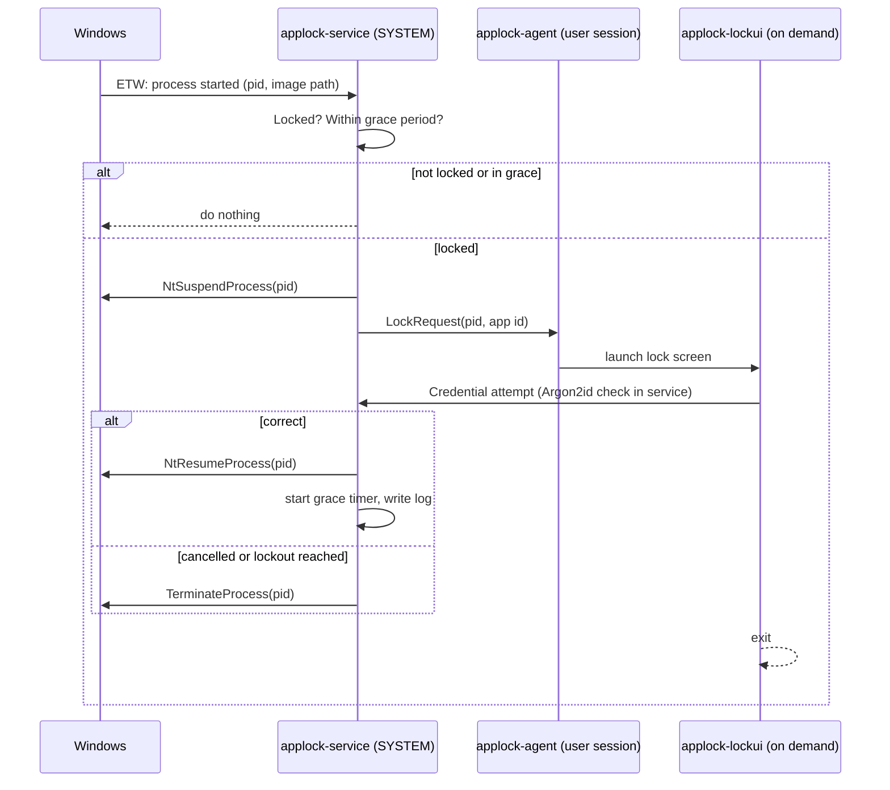

# AppLock for Windows: Product Requirements Document (PRD)

| Field | Value |
|---|---|
| Product (working name) | AppLock for Windows |
| Document version | 1.0 |
| Date | 2026-11-25 |
| Owner | Product owner (non-technical) |
| Implementation language | Rust (stable) |
| Platforms | Windows 10 (1809+) and Windows 11, x64 and ARM64 |
| Status | Ready for M0 (technical spike) |

> This PRD is the single source of truth for **what** we build. `AGENTS.md` says **how agents must work**. `PROJECT_STRUCTURE.md` says **where things live**. `DESIGN.md` says **how the UI looks and reads**.

---

## 1. Summary

AppLock asks for authentication before a protected Windows app can be used. Someone who gets hold of the laptop cannot open the user's locked apps. In a later release it also protects files, folders and disks.

The product has one hard constraint: it must be **light and lag-free**. Idle CPU is about 0%, RAM is tiny, nothing polls, and the lock screen appears almost instantly.

## 2. Problem and goals

### Problem
Windows has no built-in way to put a password on an individual app. A shared or borrowed laptop exposes every app on it: browsers, chat, banking, photos, work tools.

### Goals
1. Lock any installed app (classic Win32 and Microsoft Store/UWP) behind a password, PIN or Windows Hello.
2. Let the user recover access without a backend server (recovery codes, plus Google/Microsoft sign-in).
3. Stay within the performance budgets in section 7. The user should never feel the app.
4. Be honest about security limits. Never promise protection we cannot deliver.
5. Ship small, frequent, signed releases through GitHub Releases. Every feature and every fix is its own version.

### Non-goals (v1)
- Not an antivirus, firewall or parental-control suite.
- No protection against a determined attacker with Administrator rights, Safe Mode or boot from USB (BitLocker plus BIOS password is the answer to those; see section 9).
- No cloud account, no server, no telemetry.
- No macOS, Linux, Android or iOS.
- No kernel driver in v1 (optional hardened mode later).

## 3. Users

| Persona | Need | What matters most |
|---|---|---|
| **Everyday user** (main) | Stop family, friends or coworkers from opening WhatsApp, browser, photos, etc. | Setup under 3 minutes, no tech words |
| **Shared-laptop user** | Different locked apps for different moments (Work, Night, Kids) | Profiles and schedules |
| **Privacy-minded user** | Know who tried to get in | Attempt logs, optional intruder photo |
| **Student / low-end PC user** | Old hardware, 4 GB RAM | Zero lag, tiny footprint |

Primary UI languages: **English and Urdu (RTL)**.

## 4. Release plan

| Release | Contents | Target |
|---|---|---|
| **M0: Spike** | Prove detect, freeze, show lock window, resume/kill, with measured latency | Week 1-2 |
| **v0.x: MVP** | Win32 app locking, password and PIN, lockout, basic manager, installer, CI/CD | Week 3-8 |
| **v1.0** | UWP apps, Windows Hello, profiles, grace period, schedule, recovery codes, Google/Microsoft recovery, intruder log and selfie, tamper protection, English/Urdu | Week 9-16 |
| **v1.x** | Update check (opt-in), config backup/restore, polish | After v1.0 |
| **v2.0** | Explorer right-click lock, Folder Manager, Quick Lock, Secure Vault, BitLocker guidance | Later |
| **v2.x (optional)** | Hardened driver mode | Later, needs signing budget |

Versioning rule: **every merged `feat` or `fix` creates a new GitHub Release** (see `AGENTS.md` section 8).

## 5. Functional requirements

Priority: **P0** = must ship in that release, **P1** = should, **P2** = nice to have.

### 5.1 App locking

| ID | Requirement | Priority | Acceptance criteria |
|---|---|---|---|
| FR-APP-01 | **App discovery.** List installed apps from Start Menu shortcuts, Uninstall registry keys, UWP packages, plus manual "Browse .exe". | P0 | List shows name and icon; opens in under 1 s; no duplicates; works without admin. |
| FR-APP-02 | **Lock / unlock an app** with a single toggle. Identified by signed exe path or hash (Win32) and Package Family Name (UWP). | P0 | Renaming the exe or copying it to another folder does not bypass the lock for signed apps (publisher plus product name match). |
| FR-APP-03 | **Launch interception.** When a locked app's process starts, it is frozen before it shows a usable window, and the lock screen appears. | P0 | p95 time from process start to frozen under 50 ms (target, validated in M0). Correct credential resumes it. Cancel or wrong-lockout terminates it. |
| FR-APP-04 | **New-window interception.** Apps that reuse a running process (browsers, chat apps) are caught when a new window of a locked app comes to the foreground. | P0 | Clicking a locked app's icon while its process runs in the background still shows the lock screen. |
| FR-APP-05 | **Lock modes:** always ask; grace period (1/5/15/30 min, per app); re-lock on Windows lock, sleep or idle timeout; schedule (days and time ranges). | P0 (always + grace), P1 (rest) | Each mode covered by automated tests with a fake clock. |
| FR-APP-06 | **Profiles** (Work, Night, Kids or custom), each with its own locked-app list and schedule. Switching profile needs authentication. | P1 | Profile switch applies in under 1 s. |
| FR-APP-07 | **UWP / Store apps** handled by Package Family Name; `ApplicationFrameHost` is handled correctly. | P0 for v1.0 | Locked Store app (e.g. Calculator) shows lock before content. |
| FR-APP-08 | **Already-running locked apps** at service start or when a rule is added are handled per setting: "lock on next focus" (default) or "close now". | P1 | No locked app stays usable without a prior unlock. |
| FR-APP-09 | **Pause protection** from the tray, for a chosen time, needs authentication. | P1 | Auto-resumes after the timer; logged. |
| FR-APP-10 | **Fail closed.** If the lock screen is killed, the app stays frozen and the lock screen is re-launched. | P0 | Killing the lock UI never grants access. |

### 5.2 Authentication

| ID | Requirement | Priority | Acceptance criteria |
|---|---|---|---|
| FR-AUTH-01 | **First-run wizard:** set password or PIN, link recovery email, save recovery codes, pick apps. | P0 (credential), P1 (rest) | A new user finishes in under 3 minutes without help. |
| FR-AUTH-02 | **Password** hashed with Argon2id (per-install random salt). | P0 | Hash and salt only on disk; the plaintext is wiped from memory after use. |
| FR-AUTH-03 | **PIN**, 4 to 8 digits, Argon2id. | P0 | PIN pad with keyboard and mouse. |
| FR-AUTH-04 | **Escalating lockout** on wrong attempts: 30 s, 1 m, 5 m, 30 m, counted by the service and kept across reboots. | P0 | Restarting the lock UI or the PC does not reset the counter. |
| FR-AUTH-05 | **Windows Hello** (fingerprint, face, Hello PIN) through `UserConsentVerifier`. Shown only if the device supports it. | P1 (v1.0) | Option hidden on devices without Hello; fallback to password/PIN always available. |
| FR-AUTH-06 | **Recovery codes:** 10 one-time codes, shown once at setup, stored only as hashes. Each works once. | P0 for v1.0 | Used code is rejected on second use; regenerate needs authentication. |
| FR-AUTH-07 | **Email recovery:** OAuth 2.0 / OIDC with PKCE through the system browser (Google and Microsoft). Reset is allowed only if the verified email equals the registered email. Forces a fresh sign-in (`prompt=login`). | P1 (v1.0) | Works without any server of ours. Wrong account is rejected. |
| FR-AUTH-08 | **Change password / PIN / recovery email** (needs current credential). | P0 | Old credential stops working immediately. |
| FR-AUTH-09 | **Intruder log and optional selfie** after N wrong attempts (default 3). The selfie is **opt-in**, stored locally only, with a visible indicator in settings. | P1 (v1.0) | No photo is ever taken unless the user enabled it. Photos are deletable. |

### 5.3 Tamper protection

| ID | Requirement | Priority | Acceptance criteria |
|---|---|---|---|
| FR-TAMP-01 | Service cannot be stopped or reconfigured by a standard user; auto-restarts on failure; watchdog restarts the agent. | P0 | Standard user cannot stop it; a crash is recovered in under 5 s. |
| FR-TAMP-02 | Opening the Manager needs authentication. | P0 | Config is unreadable to standard users. |
| FR-TAMP-03 | Uninstall needs authentication. | P1 | Installer's uninstall path asks for the AppLock credential. |
| FR-TAMP-04 | Config files carry a restrictive ACL; each write is atomic; integrity is checked on load. | P0 | A tampered config is detected and the previous valid copy is restored; the event is logged. |
| FR-TAMP-05 | IPC accepts only our own signed binaries and validates every message. | P0 | A fake client cannot unlock an app (tested). |

### 5.4 Files, folders and disks (v2.0)

| ID | Requirement | Priority | Acceptance criteria |
|---|---|---|---|
| FR-VAULT-01 | **Explorer right-click** "Lock with AppLock" (Windows 11 modern menu through `IExplorerCommand`, plus classic verb for Windows 10). | P0 for v2.0 | Appears on files, folders, drives. |
| FR-VAULT-02 | **Quick Lock** (light): hide plus ACL deny. Clearly labelled **"convenience, not strong security"**. | P0 | A standard user cannot open the item without unlocking. |
| FR-VAULT-03 | **Secure Vault** (strong): encrypted container (XChaCha20-Poly1305), mounted as a drive or folder on unlock (WinFsp), unmounted on lock. | P1 | Contents are unreadable without the vault key, even for an admin offline. |
| FR-VAULT-04 | **Folder Manager** in the Manager app: list, add, remove, group, choose Quick or Secure, put locked items under any profile. | P0 | Full CRUD with authentication. |
| FR-VAULT-05 | **Disk protection guidance:** detect BitLocker availability and guide the user; Windows Home users are pointed to Secure Vault. We do not re-implement disk encryption. | P1 | Clear status screen: protected / not protected. |

### 5.5 General

| ID | Requirement | Priority |
|---|---|---|
| FR-GEN-01 | English and Urdu (RTL), switchable at runtime; all strings externalized. | P1 (v1.0) |
| FR-GEN-02 | Light and dark theme follow the system, with manual override. | P0 |
| FR-GEN-03 | Local activity log: unlock success/failure, config changes, tamper events. Capped size, rotated, no secrets. Viewable and clearable. | P0 |
| FR-GEN-04 | Tray icon (optional, off by default): pause and open Manager. | P1 |
| FR-GEN-05 | Update check against GitHub Releases: **opt-in**, never resident, verifies SHA-256 and signature. | P2 (v1.x) |
| FR-GEN-06 | Config backup and restore (encrypted export), needs authentication. | P2 |
| FR-GEN-07 | Accessibility: full keyboard use, screen-reader names, AA contrast, respects reduced-motion and system DPI. | P0 |

## 6. Architecture overview

### 6.1 Components

| # | Component | Runs as | Lifetime | Job |
|---|---|---|---|---|
| 1 | `applock-service` | SYSTEM Windows service | Always | Listens to process-start events (ETW), decides lock or allow, freezes the process, verifies credentials, holds the rules and lockout state, handles session and power events. |
| 2 | `applock-agent` | User, hidden, no window | Always (per logon) | Tiny helper in the user session. Watches foreground and new-window events (`SetWinEventHook`), reports them to the service, launches the lock screen on request. |
| 3 | `applock-lockui` | User | **On demand** only | The lock screen. Starts, takes the credential, sends it to the service, exits. |
| 4 | `applock-manager` | User | Only when the user opens it | Settings, apps, profiles, logs, folder manager. |
| 5 | `applock-shellext` (v2) | Explorer-loaded DLL | Loaded by Explorer | Right-click menu. |
| 6 | `applock-vault` (v2) | Library, used by service | n/a | Encrypted containers and mount. |

> **Why an agent exists:** the service lives in Windows "Session 0" and cannot show UI or see windows of the logged-in user. Some apps (browsers, chat apps) do not start a new process when you click their icon. Only an in-session watcher can see those. The agent stays tiny (target 3 MB) and is purely event-driven.

### 6.2 Lock flow



Rules of this flow:
- The **service is the only judge**. The lock screen never sees hashes or rules; it only sends attempts and receives yes/no.
- The process stays frozen until the service decides. Killing the lock screen does not unlock anything (fail closed).
- Foreground and new-window events from the agent follow the same decision path.

### 6.3 IPC
- Windows **named pipe**, local only, explicit ACL, no remote access.
- Client identity is checked by the service (process id, image path and Authenticode signature; hash-pinned in dev builds).
- Versioned binary messages (small, schema-checked), a maximum message size, per-request nonce, and timeouts.
- Fuzz tests are mandatory for the message parser.

### 6.4 Storage
- `%ProgramData%\AppLock\` with an ACL of SYSTEM and Administrators only.
- `config.bin`: serialized settings, encrypted with **DPAPI (machine scope)**; optional TPM-bound key in a later release.
- `logs/`, `intruder/`: capped, rotated.
- Secrets are never written in plain text and never logged.

### 6.5 Data model (simplified)

```
Config
 ├─ version
 ├─ auth { passwordHash, pinHash, hashParams, biometricsEnabled,
 │         recoveryEmail, recoveryProvider, recoveryCodeHashes[] }
 ├─ lockout { failedCount, lockedUntil }
 ├─ settings { language, theme, graceDefault, idleRelock, selfieEnabled, updateCheck }
 ├─ profiles[] { id, name, schedule, lockedItems[] }
 ├─ lockedApps[] { appId, kind(win32|uwp), exeIdentity | packageFamilyName,
 │                 mode, gracePeriod }
 └─ vaults[] { id, path, type(quick|secure), meta }   // v2.0
```

### 6.6 Crypto choices

| Use | Choice |
|---|---|
| Password and PIN hashing | Argon2id, per-install salt, parameters calibrated to roughly 250 ms (start at 32 MiB memory, 3 iterations, 1 lane), stored with the hash so they can be upgraded |
| Comparison | Constant time |
| Vault encryption (v2) | XChaCha20-Poly1305, key derived with Argon2id |
| Config at rest | DPAPI machine scope |
| Randomness | OS CSPRNG only |
| Memory | `zeroize` on all secret buffers |

No custom crypto, ever.

## 7. Non-functional requirements

### 7.1 Performance and weight budgets (hard limits, enforced in CI)

| Metric | Target | Notes |
|---|---|---|
| Idle CPU (all components) | ~0% | No polling anywhere. |
| `applock-service` private RAM, idle | ≤ 8 MB | Argon2 verification may spike briefly (tens of MB for under 1 s) and must release it immediately. |
| `applock-agent` RAM, idle | ≤ 3 MB | No window, no UI toolkit. |
| `applock-lockui` | Not resident | Cold start to first frame ≤ 150 ms. |
| `applock-manager` | Not resident | Cold start ≤ 500 ms. |
| Detect to frozen (p95) | ≤ 50 ms | To be proven in M0. |
| Credential check | ≤ 300 ms | |
| Service start impact on boot | ≤ 100 ms | Heavy work deferred. |
| Binary size | service ≤ 2.5 MB, agent ≤ 1 MB, lockui ≤ 6 MB, manager ≤ 8 MB | Release profile with LTO and strip. |
| Installer | ≤ 10 MB | Total on disk ≤ 25 MB. |
| Additional launch delay of an **unlocked** app | Not measurable (under 5 ms) | Decision is an in-memory lookup. |

> These numbers are **targets, not guarantees**. M0 measures reality; if a number is not achievable, we change the number in this PRD on purpose, with evidence, never silently.

### 7.2 Security
- Least privilege: only the service is SYSTEM. Agent, lock screen and Manager run as the user.
- Memory-safe code (Rust). `unsafe` only in designated crates with documented invariants.
- Validate everything that crosses a process boundary.
- Dependencies audited in CI (advisories, licenses, duplicate versions).
- Reproducible-as-possible release builds, signed binaries, SHA-256 checksums, build provenance attestation.
- No network access except OAuth recovery (user-initiated) and the opt-in update check.

### 7.3 Privacy
- No telemetry and no analytics. Everything stays on the device.
- Intruder photos: opt-in, local, deletable, never uploaded.
- Email is stored only to compare against the verified recovery identity.

### 7.4 Compatibility
- Windows 10 1809+ and Windows 11, x64 and ARM64.
- Standard-user and Administrator accounts.
- DPI scaling 100% to 300%, multi-monitor.
- Windows Home, Pro, Enterprise.

### 7.5 Reliability
- Atomic config writes plus a last-known-good copy.
- Service survives crashes (SCM recovery actions) and agent loss (watchdog).
- If the config is corrupt, fail **closed** for already-known locked apps using the last good copy.

## 8. UX specification (summary)

Visual and copy rules live in `DESIGN.md`. Screens:

1. **Lock screen:** app icon and name, PIN pad or password field, "Use Windows Hello" (if available), "Forgot password?", remaining lockout time when locked out.
2. **First-run wizard:** 4 short steps (credential, recovery, codes, apps).
3. **Manager > Apps:** searchable list, toggle per app, mode and grace per app.
4. **Manager > Profiles and schedule.**
5. **Manager > Security:** change credentials, Hello, recovery, intruder settings.
6. **Manager > Activity:** log with filter and clear.
7. **Manager > Folders (v2):** Folder Manager.
8. **Recovery flow:** choose code or Google/Microsoft; clear errors; set a new credential.
9. **Tray menu (optional).**

## 9. Threat model and honest limits

| Threat | Covered? | How |
|---|---|---|
| Someone opens a locked app on the user's unlocked laptop | Yes | Freeze plus lock screen. |
| Guessing the PIN or password | Yes | Argon2id plus persistent escalating lockout. |
| Killing the lock screen | Yes | Process stays frozen; relaunched (fail closed). |
| Standard user stops or uninstalls AppLock | Yes | ACL, service protection, uninstall authentication. |
| Fake IPC client says "unlocked" | Yes | Client identity checks plus nonce plus service-side decision. |
| Editing or copying the config | Mostly | ACL plus DPAPI plus integrity check. |
| **Administrator account attacker** | **No** | User-mode software cannot stop an admin. Mitigation: use a standard account for daily use. |
| **Safe Mode / USB boot / offline disk read** | **No** (for apps) | Mitigation: BitLocker plus BIOS password. Secure Vault protects files even offline. |
| **Task Manager "End task" of AppLock service** | Partly | Standard users cannot; admins can. Watchdog restarts; log records it. |
| Process starts a few milliseconds before being frozen | Accepted | Freeze happens at process creation; a tiny window exists and is measured in M0. A kernel driver (v2.x) closes it. |
| Windows Hello result is produced in the user session | Accepted | Hello is treated as convenience; password and PIN remain the root of trust. Optional "always require password for chosen apps". |

These limits must appear in the product's help text in plain words.

## 10. Release engineering requirements
- Versioning: SemVer driven by Conventional Commits.
- Every merged `feat` or `fix` produces a signed GitHub Release automatically.
- Assets per release: installer (x64, ARM64), portable zip, `SHA256SUMS.txt`, provenance attestation, changelog.
- Details: `AGENTS.md` section 8 and `PROJECT_STRUCTURE.md` section 6.

## 11. Risks

| Risk | Impact | Mitigation |
|---|---|---|
| Antivirus false positives (process freeze and kill look suspicious) | High | Code signing, submit to Microsoft Defender, clear installer description, no obfuscation. |
| Detect-to-freeze latency too slow for some apps | High | M0 spike with measurements; the agent's window events as a second line. |
| Single-instance apps behave oddly when frozen | Medium | Test matrix of the top 30 apps in M0 and every release. |
| Google OAuth app verification | Medium | Start with recovery codes; submit for verification before public launch. |
| UWP identification complexity | Medium | Dedicated tests with real Store apps. |
| Code-signing cost and delay | Medium | Unsigned builds are flagged "pre-release/unsigned" until a certificate exists. |
| Windows updates change behavior | Medium | CI matrix on current builds, scheduled regression runs. |
| Driver signing (v2.x) | Low for v1 | Optional, deferred. |
| Scope creep | High | The release plan and the non-goals list. |

## 12. Success metrics (local, measured by us in testing, no telemetry)
- All performance budgets pass in the CI benchmark job.
- Zero known bypasses for a standard user in the security test suite.
- A first-time user completes setup in under 3 minutes (usability test with 5 people).
- Less than 1 crash per 1,000 lock events in soak tests.

## 13. Milestones

| Milestone | Deliverables | Exit criteria |
|---|---|---|
| **M0 Spike** | Minimal service plus agent plus lock window; measure latency on Win10, Win11, x64, ARM64 | Budgets confirmed or PRD updated with evidence; the 30-app test matrix recorded |
| **M1 Foundation** | Workspace, CI, release pipeline, installer, signing placeholder | A tagged commit produces a downloadable release |
| **M2 MVP** | FR-APP-01/02/03/05(basic)/10, FR-AUTH-02/03/04/08, FR-TAMP-01/02/04/05, FR-GEN-02/03/07 | Internal beta works for a week on 3 PCs |
| **M3 v1.0** | Remaining P0/P1 for v1.0 | Security checklist and budgets pass |
| **M4 v2.0** | Vault features | Security review of the vault done |

## 14. Decisions needed from the owner

| # | Decision | Default if not decided |
|---|---|---|
| 1 | Final product name and logo | "AppLock" (placeholder) |
| 2 | Budget for a code-signing certificate | Unsigned pre-release builds |
| 3 | Create Google Cloud and Microsoft Entra app registrations (agent will give step-by-step help) | Recovery codes only until done |
| 4 | Create the GitHub repository and enable Actions, branch protection and auto-merge | Agent gives the exact setup steps |
| 5 | License (open source or closed) | Closed source, private repo |
| 6 | Should the intruder selfie exist in v1.0? | Yes, opt-in |
| 7 | Brand colors and tone, if different from `DESIGN.md` | `DESIGN.md` as written |

## 15. Glossary (plain words)

| Term | Meaning |
|---|---|
| **Service** | A program Windows starts at boot and keeps running in the background. |
| **Agent** | A tiny hidden helper that sees what the user is doing on screen. |
| **ETW** | Windows' built-in event feed. It tells us instantly when a program starts, with no repeated checking. |
| **Freeze (suspend)** | Pause a program without closing it. |
| **Argon2id** | A strong way to store passwords so that stolen data is useless. |
| **DPAPI** | Windows' built-in way to encrypt data for this PC. |
| **Named pipe** | A private local channel for programs on the same PC to talk to each other. |
| **PKCE / OAuth** | The safe "Sign in with Google/Microsoft" method. |
| **Fail closed** | If something breaks, access stays blocked instead of opening up. |
| **Conventional Commits** | A fixed way of naming changes (`feat:`, `fix:`) that lets automation pick the next version number. |
| **GitHub Release** | The download page on GitHub for each version. |
