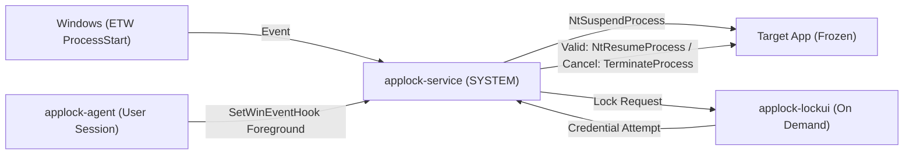

# AppLock for Windows

Lock individual Windows apps behind a PIN or password. Lightweight, event-driven, no background polling.

> **Pre-release notice:** Pre-release, do not rely on it until `FR-AUTH-01` (first-run credential setup, removing the test PIN) is merged.

---

## Download

**[→ Download AppLock v0.1.0 (Windows x64 installer)](https://github.com/MirzaAhzam/applock/releases/latest/download/applock-0.1.0-x64-setup.exe)**

Or browse all releases and release notes: [github.com/MirzaAhzam/applock/releases](https://github.com/MirzaAhzam/applock/releases)

> **Default test PIN:** `1234` — change it immediately after first install in the Manager app.

### Available packages

| File | Description |
|---|---|
| `applock-0.1.0-x64-setup.exe` | Full installer — installs service, agent, Manager, and lock UI |
| `applock-0.1.0-x64-portable.zip` | Portable — no install needed; run from any folder |
| `SHA256SUMS-x64.txt` | File checksums — verify before running |

### Installation steps (installer)

1. Download `applock-0.1.0-x64-setup.exe`
2. Right-click → **Run as administrator**
3. Follow the installer. It registers `applock-service` as a Windows service under `LocalSystem`.
4. Open **AppLock Manager** from the Start menu, enter PIN `1234`, then change it.
5. Add the apps you want to lock from the **Apps** tab.

---

## Honest Security Limits

AppLock protects against casual and standard-user access on an unlocked Windows session. It **cannot** stop:

- An account with **Administrator** rights on the same machine
- **Safe Mode** boot (services do not start)
- **Offline disk access** — anyone with physical access to your drive can read files directly

For those threats: use a **standard (non-admin) daily account**, enable **BitLocker**, and set a **BIOS password**. Full details are in [PRD.md](PRD.md) section 9.

---

## Architecture

- **Privilege separation:** Only `applock-service` runs as `SYSTEM` and decides allow/deny. UI processes never receive password hashes or the full rule table.
- **Event-driven:** Uses ETW (`Microsoft-Windows-Kernel-Process`) and `SetWinEventHook` (`EVENT_SYSTEM_FOREGROUND`) with zero polling loops and no async runtime in the service or agent.
- **Fail closed:** Errors, crashes, or closing the lock prompt keep the protected app blocked.

---

## Visual Direction

UI design follows [DESIGN.md](DESIGN.md):
- **Icons:** System **Segoe Fluent Icons** and real target app icons (no bundled icon packs or decorative illustrations).
- **Typography:** System **Segoe UI Variable** (English) and **Urdu Typesetting / Nirmala UI** (Urdu RTL).
- **Palette:** Calm neutral surfaces (`#F6F5F2` light / `#121413` dark) with a single teal-green accent (`#0B6B5D` light / `#4FD1B5` dark), 1 px borders, and WCAG AA contrast.
- **Lock screen:** Centered topmost window over a 55% black backdrop showing the locked app's real icon and name, PIN/password input, and "Cancel and close app".

---

## Measured Performance

Measured on GitHub Actions (`windows-2025`, `10.0.26100` x64):

| Metric | Limit (`PRD.md` 7.1) | Measured |
|---|---|---|
| `applock-service` idle RAM | ≤ 8.00 MiB | 1.74 MiB |
| `applock-agent` idle RAM | ≤ 3.00 MiB | 0.98 MiB |
| Idle CPU (service + agent) | ~0% | 0.000% |
| `applock-service.exe` size | ≤ 2.50 MiB | 0.30 MiB |
| `applock-agent.exe` size | ≤ 1.00 MiB | 0.28 MiB |
| `applock-lockui.exe` size | ≤ 6.00 MiB | 2.00 MiB |
| `applock-manager.exe` size | ≤ 8.00 MiB | 2.27 MiB |
| Installer size | ≤ 10.0 MiB | ~3.0 MiB |

---

## Workspace Crates

| Crate | Role | `unsafe` |
|---|---|---|
| `crates/applock-core` | Rules engine, config model, auth and lockout logic | Forbidden |
| `crates/applock-ipc` | Versioned IPC messages and validation | Forbidden |
| `crates/applock-sys` | Thin Windows API wrappers (ETW, suspend/resume, WinEventHook) | Allowed (only here) |
| `crates/applock-service` | Background Windows service binary | Forbidden |
| `crates/applock-agent` | Hidden user-session foreground watcher | Forbidden |
| `crates/applock-lockui` | Lock screen UI (Slint, software renderer) | Forbidden |
| `crates/applock-manager` | Manager UI (Slint, PIN gate, Apps/Security/Limits tabs) | Forbidden |
| `xtask` | CI budget checks and packaging helpers | Forbidden |

---

## Documentation

- [PRD.md](PRD.md) — Product requirements and performance budgets
- [PROJECT_STRUCTURE.md](PROJECT_STRUCTURE.md) — Crate layout and CI/CD pipelines
- [DESIGN.md](DESIGN.md) — Visual, typography, color, and copywriting rules
- [AGENTS.md](AGENTS.md) — Engineering and security rules
- [CONTEXT.md](CONTEXT.md) — Current milestone state and next steps
- [MEMORY.md](MEMORY.md) — Session memory and technical findings
