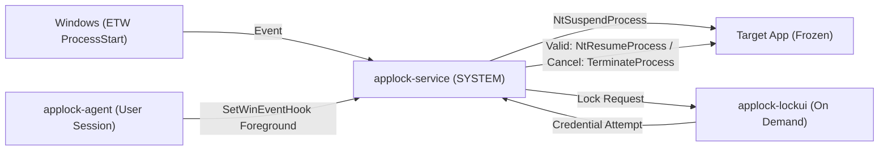

# AppLock for Windows

AppLock for Windows is a lightweight Rust application that locks individual Windows 10 and Windows 11 apps (classic Win32 and Microsoft Store/UWP) behind a password, PIN, or Windows Hello.

> **Status:** M1 foundation and M0 technical spike complete. M2 (MVP UI, Argon2id auth, named-pipe IPC, and installer) is in progress.

---

## Architecture

- **Privilege separation:** Only `applock-service` runs as `SYSTEM` and decides allow/deny. UI processes never receive password hashes or full rule tables.
- **Event-driven:** Uses ETW (`Microsoft-Windows-Kernel-Process`) and `SetWinEventHook` (`EVENT_SYSTEM_FOREGROUND`) with zero polling loops and no async runtime in the service or agent.
- **Fail closed:** Errors, crashes, or closing the lock prompt keep the protected app blocked.

---

## Visual Direction

UI design follows [DESIGN.md](DESIGN.md):
- **Icons:** System **Segoe Fluent Icons** and real target app icons (no bundled icon packs or decorative illustrations).
- **Typography:** System **Segoe UI Variable** (English) and **Urdu Typesetting / Nirmala UI** (Urdu RTL).
- **Palette:** Calm neutral surfaces (`#F6F5F2` light / `#121413` dark) with a single teal-green accent (`#0B6B5D` light / `#4FD1B5` dark), 1 px borders, and WCAG AA contrast.
- **Lock screen:** Centered topmost window over a 55% black backdrop showing the locked app's real icon and name, PIN/password input, and "Cancel and close app".

---

## Measured M0 Performance

Measured on GitHub Actions (`windows-2025`, `10.0.26100` x64) in [docs/decisions/0001-m0-spike-results.md](docs/decisions/0001-m0-spike-results.md):

| Metric | Target (`PRD.md` 7.1) | Measured (M0) |
|---|---|---|
| `applock-service` idle RAM | <= 8.00 MiB | 1.74 MiB |
| `applock-agent` idle RAM | <= 3.00 MiB | 0.98 MiB |
| Idle CPU (service + agent) | ~0% | 0.000% |
| `applock-service.exe` size | <= 2.50 MiB | 217,088 bytes (0.21 MiB) |
| `applock-agent.exe` size | <= 1.00 MiB | 184,320 bytes (0.18 MiB) |
| Detect-to-frozen (p95, 60 runs) | <= 50 ms | 1038.89 ms (user-mode ETW batching) |

---

## Workspace Crates

| Crate | Role | `unsafe` |
|---|---|---|
| `crates/applock-core` | Rules engine, config model, auth and lockout logic | Forbidden |
| `crates/applock-ipc` | Versioned IPC messages and validation | Forbidden |
| `crates/applock-sys` | Thin Windows API wrappers (ETW, suspend/resume, WinEventHook) | Allowed (only here) |
| `crates/applock-service` | Background Windows service binary | Forbidden |
| `crates/applock-agent` | Hidden user-session foreground watcher | Forbidden |
| `xtask` | CI budget checks and packaging helpers | Forbidden |

---

## Honest Security Limits

AppLock protects against casual and standard-user access on an unlocked Windows session. User-mode software cannot stop an attacker with an **Administrator** account, **Safe Mode**, or **offline disk access** (use a standard daily account plus BitLocker and a BIOS password for those). Full details are in [PRD.md](PRD.md) section 9.

---

## Documentation

- [PRD.md](PRD.md) — Product requirements and performance budgets
- [PROJECT_STRUCTURE.md](PROJECT_STRUCTURE.md) — Crate layout and CI/CD pipelines
- [DESIGN.md](DESIGN.md) — Visual, typography, color, and copywriting rules
- [AGENTS.md](AGENTS.md) — Engineering and security rules
- [CONTEXT.md](CONTEXT.md) — Current milestone state and next steps
- [MEMORY.md](MEMORY.md) — Session memory and technical findings
